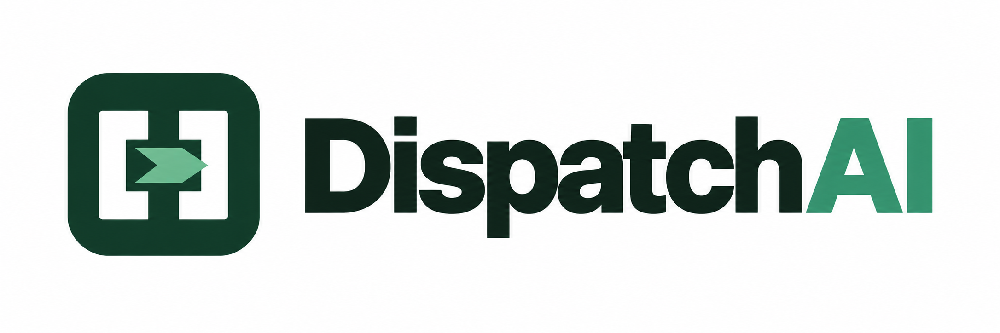

<p align="center">
  
</p>

# DispatchAI

**An open-source AI booking agent you run yourself.** It answers a small business's phone (or chat), books, moves and cancels appointments, and hands anything it cannot handle to a person. One install per business, on your own PC or server. No monthly SaaS fee, and the customer data stays on your machine.

Built for appointment businesses: field service (HVAC, plumbing), salons, auto repair and home cleaning. Missed calls are lost jobs; this answers them 24/7.

> **Status: early, pilot-ready, not battle-tested.** The booking engine, security model and install paths are covered by automated tests. Real phone calls, real email and real AI providers have **not** been exercised with live accounts yet. See [Not verified yet](#not-verified-yet).

## What it does

- **Books on the phone or in chat.** A rule-based agent collects the job, the customer and a slot, using the questions of your business type. An optional AI brain understands callers who phrase things in their own words.
- **Never books without a yes.** Every booking, reschedule and cancellation is proposed first and written only after the caller clearly confirms. The AI only reads what the caller wants; it cannot confirm anything.
- **Does not leak customer data.** A phone number is not identity: the caller must state their address (or full name) before anything is read out or changed. Wrong and unknown details get the same answer.
- **Hands over to people.** Emergencies, "let me talk to someone" and failed deliveries become tasks in the **Inbox** for your staff.
- **Plugins you switch on from the dashboard:** phone line, AI brain, email, reminders, and signed events to your own [n8n](https://n8n.io) workflows.
- **Owner and staff logins** with a PIN. Staff run the day; only the owner changes settings.

## Install

Pick one. All three give you the same dashboard.

### Windows desktop app

Runs on your PC, private, while the app is open. Build the installer (needs [Node 24+](https://nodejs.org), Rust and a C++ toolchain):

```bash
cd desktop
npm install
npm run build        # installer: src-tauri/target/release/bundle/nsis/DispatchAI_*_x64-setup.exe
```

Only one copy runs at a time, and the server stops when the app closes. Phone calls from outside need a public address (a tunnel); the in-browser **Test call** works without one. The installer is not code-signed, so Windows SmartScreen may warn.

### Docker, on your PC

```bash
cp .env.example .env        # optional: set SETUP_TOKEN
docker compose up -d --build
docker compose logs app     # shows the one-time setup code if SETUP_TOKEN is empty
```

Open <http://localhost:8080/app>, enter the setup code, choose a name and PIN, then follow the onboarding wizard.

### Docker, on a server (24/7)

On a Linux server with Docker and the compose plugin, with your domain's DNS already pointing at it:

```bash
curl -fsSL https://raw.githubusercontent.com/MAhsaanUllah/DispatchAI/main/scripts/install-vps.sh | bash -s -- --domain bookings.example.com
```

The script clones the project to `/opt/dispatchai`, writes a `.env` with fresh secrets (never over an existing one), starts the stack with the `vps` profile, waits until it is healthy and prints the URL and the one-time setup code. Add `--with-n8n` to run n8n on the same server, `--dir PATH` to install elsewhere, and `--dry-run` to see what it would do. Do it by hand instead:

```bash
# .env: SETUP_TOKEN, MASTER_KEY (long random value), PUBLIC_URL, PUBLIC_DOMAIN (DNS points here), TRUST_PROXY=true
docker compose --profile vps up -d --build
```

Caddy gets an HTTPS certificate for `PUBLIC_DOMAIN`. Phone calls reach the server directly. Keep `.env` safe: it holds `MASTER_KEY`.

| Profile | Adds | Use it for |
| --- | --- | --- |
| *(none)* | the app, on `127.0.0.1:8080` | home PC |
| `automation` | n8n at `http://localhost:5678` | your own workflows |
| `tunnel` | a Cloudflare Tunnel | phone calls to a PC (set `TUNNEL_TOKEN`) |
| `vps` | Caddy with automatic HTTPS | a public server |

Data lives in one SQLite file in the `app-data` volume, next to `master.key`.

## Plugins

Each plugin is a card on the **Plugins** page: paste the key, press **Test**, switch it on. Keys are encrypted with `MASTER_KEY` (or an auto-created `master.key`) and are never shown again.

| Plugin | Does | You need |
| --- | --- | --- |
| Phone line (Twilio) | Answers calls to your number with the same agent; forwards to staff while open, otherwise creates a call-back task | Twilio account and a public HTTPS address |
| AI brain | Understands free-form speech | A key for OpenAI, Anthropic, Gemini, xAI Grok, Groq or Cloudflare Workers AI, or [Ollama](https://ollama.com) running locally (no key) |
| Email | Booking, change and cancel emails | A [Resend](https://resend.com) key and a verified sender |
| Reminders | An email before each appointment (2, 12, 24 or 48 hours); catches up after downtime, at most once | The Email plugin |
| n8n events | A signed event per booking change to your n8n workflow | An n8n webhook URL and a shared secret |
| Public address (Cloudflare Tunnel) | Gives a PC or the desktop app a public HTTPS address for the phone line or an AI assistant. The server runs `cloudflared` for you: a temporary address needs no account (it changes on every start), or use your own tunnel token for a stable hostname | The `cloudflared` program on the computer (on Windows: `winget install Cloudflare.cloudflared`, or set `CLOUDFLARED_PATH`) |

If a plugin fails, the booking still happens: email and n8n are retried in the background and a delivery that gives up appears in the Inbox. If the AI brain is down or out of quota, the built-in rules keep answering.

### n8n, for anything custom

n8n is optional. Booking works without it. Use it when you want something no plugin does (a Google Sheet row, a WhatsApp message, your CRM). DispatchAI POSTs a small JSON event with IDs only, no names or addresses, signed with HMAC-SHA256 over `timestamp.body`:

```
x-dispatchai-event: booking.created | booking.rescheduled | booking.cancelled
x-dispatchai-timestamp: <unix seconds>
x-dispatchai-signature: <hex hmac>
```

`n8n/workflows/dispatchai-events-starter.json` verifies the signature and routes by event. With `--profile automation` it is imported into n8n on first start. Then:

1. Put the same long random value in `N8N_EVENTS_SECRET` in `.env` (n8n reads it as `DISPATCHAI_EVENTS_SECRET`) and restart the stack.
2. Open n8n (<http://localhost:5678>), open **DispatchAI Events Starter** and **publish** it. Until it is published the webhook answers 404.
3. In the dashboard, add the webhook URL (inside Docker: `http://n8n:5678/webhook/dispatchai-events`) and the same secret, then press **Test**. A wrong secret is reported as "n8n rejected the signature".

Replace the three "(replace me)" nodes with your own steps (a Google Sheet row, a WhatsApp message, your CRM).

## Developer API and MCP

For your own software, or for an AI assistant you trust. Both use keys that only the owner can create, so a key never exposes anything beyond this one business.

Create a key (owner session; a dashboard screen for this is planned). The key is shown **once**, only a hash is stored, and revoking it stops it at once:

```bash
curl -b cookies.txt -X POST http://localhost:8080/api/api-keys -H "Content-Type: application/json" -d '{"name":"Website form","scope":"read"}'   # scope: read | write
```

**Developer API** (`Authorization: Bearer dsp_...`):

| Call | Key | Does |
| --- | --- | --- |
| `GET /api/v1/bookings` | read | list bookings |
| `GET /api/v1/free-times?serviceType=HVAC&serviceZone=North&date=2026-11-20` | read | free slots |
| `POST /api/v1/customers/find` `{"phone":"..."}` | read | find a customer |
| `POST /api/v1/customers` `{"name","phone","addressLine1","serviceZone"}` | write | create a customer |
| `POST /api/v1/bookings` | write | book (`customerId`, `propertyId`, `serviceType`, `issueSummary`, `slotId`, `idempotencyKey` in the body or an `Idempotency-Key` header) |
| `POST /api/v1/bookings/{id}/reschedule` `{"newSlotId"}` · `/cancel` `{"reason"}` | write | change a booking |

A write goes through the same service, emails and n8n events as a phone booking. A read key that tries to write gets `403` and opens one task in the Inbox.

**MCP** (for Claude or another assistant that speaks MCP over HTTP): point it at `https://YOUR-HOST/api/mcp` with the key as a Bearer token. A read key gets four look-up tools (`list_bookings`, `get_booking`, `find_customer`, `free_times`). A write key also gets `propose_booking`, `propose_reschedule`, `propose_cancel` and `confirm`: a change is only a proposal until `confirm` is called with the returned id (single use, 5 minutes, only by the key that proposed it). The tool descriptions tell the assistant to ask you first; the server enforces the two steps, not your "yes". Customer names and addresses go to your assistant's provider, so use a read key unless you need more.

## Back up your data

The owner can download one backup file from the dashboard (System page) or `GET /api/backup`. It contains a consistent database snapshot and the `master.key` that decrypts your plugin keys, so **keep it private**. A `MASTER_KEY` set in the environment is never put in the file; store it in your secret manager.

Restore is offline, on purpose: stop the server, then

```bash
node ./node_modules/vite-node/dist/cli.mjs packages/agent/src/bin/restore-backup.ts backup.json /data/dispatchai.sqlite [--force]
```

It never deletes anything: with `--force` the old database and key are moved aside as `*.before-restore-<time>`.

### Move from your PC to a server

1. On the PC, download the backup (System page) and copy `backup.json` to the server.
2. Install on the server with the script above, but do **not** finish the setup page.
3. The server's `.env` has its own `MASTER_KEY`; your saved plugin keys were encrypted with the PC's key. Make the PC's key the server's key, then restore over the empty server database:

```bash
cd /opt/dispatchai
KEY=$(grep -o '"masterKey":"[^"]*"' backup.json | cut -d'"' -f4)
sed -i "s|^MASTER_KEY=.*|MASTER_KEY=$KEY|" .env
docker compose stop app
docker compose run --rm --no-deps -v "$PWD/backup.json:/in/backup.json:ro" app node ./node_modules/vite-node/dist/cli.mjs packages/agent/src/bin/restore-backup.ts /in/backup.json /data/dispatchai.sqlite --force
docker compose up -d app
```

Log in with your usual name and PIN. Then switch the PC install off: two installs must never share one customer base (each keeps its own database).

## Security

- First-run setup needs a one-time code (`SETUP_TOKEN`, or one printed in the server log). PINs are hashed with PBKDF2-SHA256 (600k iterations). Sessions use an HttpOnly, SameSite=Strict cookie (Secure behind HTTPS). Five wrong PINs lock a login for 15 minutes.
- Roles are enforced on the server: staff get `403` when they try to change plugins, logins, business settings or staff, download a backup, or reset data.
- Twilio webhooks are verified by signature; n8n events are signed. Plugin keys are AES-GCM encrypted at rest.
- The dashboard sends a strict Content-Security-Policy.
- Synthetic demo data (`SEED_DEMO_DATA=true`) is fictional; a real install starts empty.

## How it works

```
caller / dashboard ──► one Node server ──► SQLite file
   (Test call, Twilio)   ├─ rule-based agent + confirmation gate
                         ├─ optional AI brain (reads intent only)
                         └─ plugins: email · reminders · n8n events · phone
```

One process owns the database (a single writer). TypeScript monorepo: `packages/shared` (schemas), `packages/domain` (bookings, slots, templates), `packages/agent` (agent, plugins, server), `packages/web` (React dashboard), `desktop` (Tauri shell).

## Develop

Needs Node 24+.

```bash
npm install
cp .env.example .env
npm run dev:agent            # API on :8787, prints the setup code
npm run dev                  # dashboard on :5173, proxies /api
npm test                     # unit tests (agent, domain, shared, web)
npm run typecheck
npx playwright install chromium                            # once
npm run build --workspace=@dispatchai/web && npm run e2e   # Playwright: setup, login, onboarding, booking
node scripts/docker-smoke.mjs http://localhost:8080        # smoke test of a running install
```

Add a business type in `packages/domain/src/templates.ts`; add a plugin in `packages/agent/src/plugins.ts` (fields, validation, test).

## Not verified yet

Honest list, so nobody trusts what has not been tried:

- A **real phone call** through Twilio: speech recognition quality, delays and timeouts. Only recorded fixtures were used.
- **Real email** through Resend and **cloud AI providers**. Their request formats are tested against fixtures; model names in the form are examples, check your provider's docs. The AI brain was run end to end only with a local Ollama model.
- The `vps` profile was run with Caddy on `localhost` (local certificate), not with a real domain; the `tunnel` profile was not run.
- A real Claude or ChatGPT connector against `/api/mcp` (it needs a public HTTPS address). It was exercised with the official MCP SDK client only.
- Windows installer signing, auto-update and macOS/Linux desktop builds.
- Calendar sync: slots come from the opening hours and staff you enter, not from a live calendar. SMS and Google Calendar are planned.

## AI assistance

DispatchAI is designed and directed by Ahsaan Ullah and built with AI assistance (Claude Code). The product decisions, priorities and testing on real machines are the maintainer's; the code is checked by the test suite, the end-to-end run and the container smoke test described above.

## Contributing

Issues and pull requests are welcome; see [CONTRIBUTING.md](CONTRIBUTING.md). Please keep changes small and include a test.

## License

[MIT](LICENSE)
